# ER diagram

Keys and the most important columns only. Full field lists are in `data_dictionary.md`.

Cardinality symbols: `||` exactly one, `|o` zero or one, `o{` zero or many, `|{` one or many.

```mermaid
erDiagram
    CURRENCY ||--o{ LEGAL_ENTITY : "functional currency"
    CURRENCY ||--o{ BANK_ACCOUNT : "account currency"
    CURRENCY ||--o{ CURRENCY_RATE : "quote currency"
    LEGAL_ENTITY |o--o{ LEGAL_ENTITY : "parent of"
    LEGAL_ENTITY ||--o{ BANK_ACCOUNT : owns
    LEGAL_ENTITY ||--o{ RECEIVABLE : owns
    LEGAL_ENTITY ||--o{ PAYABLE : owns
    BANK_ACCOUNT ||--o{ RECEIVABLE : "expected receipt account"
    BANK_ACCOUNT ||--o{ PAYABLE : "paying account"
    BANK_ACCOUNT ||--o{ LEDGER_ENTRY : posts
    BANK_ACCOUNT ||--o{ DAILY_CASH_POSITION : "daily position"
    CURRENCY_RATE |o--o{ LEDGER_ENTRY : converts
    CURRENCY_RATE |o--o{ DAILY_CASH_POSITION : converts
    CURRENCY_RATE |o--o{ CASH_FLOW_FORECAST : converts
    LEDGER_ENTRY |o--o| LEDGER_ENTRY : reverses
    RECEIVABLE ||--o{ SETTLEMENT_LINK : "settled by"
    PAYABLE ||--o{ SETTLEMENT_LINK : "settled by"
    LEDGER_ENTRY ||--o{ SETTLEMENT_LINK : settles
    RECEIVABLE ||--|{ RECEIVABLE_STATUS_EVENT : history
    PAYABLE ||--|{ PAYABLE_STATUS_EVENT : history
    LEDGER_ENTRY |o--o{ RECEIVABLE_STATUS_EVENT : triggers
    LEDGER_ENTRY |o--o{ PAYABLE_STATUS_EVENT : triggers
    LIQUIDITY_SCENARIO ||--o{ FORECAST_RUN : parameterises
    FORECAST_RUN |o--o| FORECAST_RUN : supersedes
    FORECAST_RUN ||--|{ FORECAST_RUN_STATUS_EVENT : history
    FORECAST_RUN ||--o{ CASH_FLOW_FORECAST : contains
    BANK_ACCOUNT ||--o{ CASH_FLOW_FORECAST : "forecast for"
    RECEIVABLE |o--o{ CASH_FLOW_FORECAST : "forecast source"
    PAYABLE |o--o{ CASH_FLOW_FORECAST : "forecast source"
    FORECAST_RUN ||--o{ FORECAST_DAILY_PROJECTION : projects
    LEGAL_ENTITY ||--o{ FORECAST_DAILY_PROJECTION : "projected for"
    FORECAST_RUN ||--o{ FORECAST_VS_ACTUAL : compares
    CASH_FLOW_FORECAST |o--o{ FORECAST_VS_ACTUAL : "forecast side"
    LEDGER_ENTRY |o--o{ FORECAST_VS_ACTUAL : "actual side"

    CURRENCY {
        string currency_code PK
        int minor_unit_exponent
        int is_base
    }
    LEGAL_ENTITY {
        string entity_id PK
        string functional_currency FK
        string parent_entity_id FK
        string status
    }
    BANK_ACCOUNT {
        string bank_account_id PK
        string entity_id FK
        int account_seq
        string currency FK
        int opening_balance_minor
        string opening_date
    }
    CURRENCY_RATE {
        string rate_id PK
        string rate_date
        string quote_currency FK
        string base_currency FK
        float rate
    }
    RECEIVABLE {
        string receivable_id PK
        string entity_id FK
        string bank_account_id FK
        int amount_minor
        string expected_date
        string status
    }
    PAYABLE {
        string payable_id PK
        string entity_id FK
        string bank_account_id FK
        int amount_minor
        int is_one_off
        string expected_date
        string status
    }
    LEDGER_ENTRY {
        string ledger_entry_id PK
        string bank_account_id FK
        string entry_date
        string direction
        int amount_minor
        string fx_rate_id FK
        string reverses_ledger_entry_id FK
    }
    SETTLEMENT_LINK {
        int settlement_link_id PK
        string receivable_id FK
        string payable_id FK
        string ledger_entry_id FK
        int allocated_amount_minor
    }
    RECEIVABLE_STATUS_EVENT {
        int event_id PK
        string receivable_id FK
        int event_seq
        string to_status
        string ledger_entry_id FK
    }
    PAYABLE_STATUS_EVENT {
        int event_id PK
        string payable_id FK
        int event_seq
        string to_status
        string ledger_entry_id FK
    }
    LIQUIDITY_SCENARIO {
        string scenario_id PK
        string scenario_code
        int receipt_delay_days
        int collection_haircut_bps
        int fx_shock_bps
        int one_off_multiplier_bps
    }
    FORECAST_RUN {
        string forecast_run_id PK
        string scenario_id FK
        string cutoff_date
        int version_no
        string supersedes_run_id FK
        string status
    }
    FORECAST_RUN_STATUS_EVENT {
        int event_id PK
        string forecast_run_id FK
        int event_seq
        string to_status
    }
    CASH_FLOW_FORECAST {
        string cash_flow_forecast_id PK
        string forecast_run_id FK
        string bank_account_id FK
        string receivable_id FK
        string payable_id FK
        string source_ledger_entry_id FK
        string source_data_date
        int forecast_amount_minor
    }
    DAILY_CASH_POSITION {
        string bank_account_id PK
        string position_date PK
        int opening_minor
        int closing_minor
        string fx_rate_id FK
        int closing_base_minor
    }
    FORECAST_DAILY_PROJECTION {
        string forecast_run_id PK
        string entity_id PK
        string projection_date PK
        int projected_closing_base_minor
        int shortfall_flag
    }
    FORECAST_VS_ACTUAL {
        string comparison_id PK
        string forecast_run_id FK
        string cash_flow_forecast_id FK
        string actual_ledger_entry_id FK
        int variance_base_minor
        string variance_driver
    }
```

## Reading the diagram

- **N:M** is `RECEIVABLE` / `PAYABLE` ↔ `LEDGER_ENTRY`, resolved by `SETTLEMENT_LINK`. The link has two nullable parent keys and a CHECK that exactly one is set.
- `FORECAST_DAILY_PROJECTION` is a run × entity grid resolved by its composite key.
- `FORECAST_VS_ACTUAL` joins the forecast side and the actual side; either may be missing (unforecast actual, or forecast not yet realised).
- `FORECAST_RUN` self-link is the version chain: a re-run points at the run it supersedes.
- `ground_truth` is not in the diagram or the database. It is a separate file.
